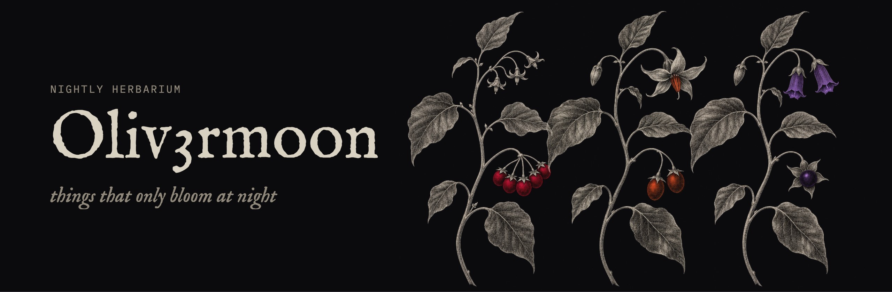

**nightly herbarium** · PS5 homebrew, grown after dark

| n° | specimen | | what it is |
| :-- | :-- | :-- | :-- |
| 01 | [Nightshade](https://github.com/Oliv3rmoon/Nightshade) · *Solanum nigrum* | ● in bloom | Switch games on a jailbroken PS5 |
| 02 | [Dulcamara](https://github.com/Oliv3rmoon/Dulcamara) · *Solanum dulcamara* | ● in bloom · 2.0 budding | RPG Maker and Ren'Py games on a PS5 |
| 03 | [Belladonna](https://github.com/Oliv3rmoon/Belladonna) · *Atropa belladonna* | ◐ budding | the Vulkan driver underneath Nightshade |
| 04 | [Solanum](https://github.com/Oliv3rmoon/Solanum) · *Solanum* | ● in bloom | a store for open-source PS5 homebrew |
| 05 | [Physalis](https://github.com/Oliv3rmoon/Physalis) · *Physalis alkekengi* | ● in bloom | live TV |
| 06 | [Mandrake](https://github.com/Oliv3rmoon/Mandrake) · *Mandragora officinarum* | ◌ dormant | PS1 |
| 07 | [Datura](https://github.com/Oliv3rmoon/Datura) · *Datura stramonium* | ◌ dormant | game streaming |
| 08 | [Petunia](https://github.com/Oliv3rmoon/Petunia) · *Petunia* | ◌ dormant | internet radio |
| 09 | ███████ | | |

● runs on a PS5 · ◐ in development · ◌ parked, downloads stay up

also: [welp](https://github.com/Oliv3rmoon/welp) fixes the command you just typed wrong · [uhh](https://github.com/Oliv3rmoon/uhh) tells you what a command does before it does it · [compat log](https://github.com/Oliv3rmoon/eden-ps5-compat) what runs, what crashes

the garden opens at night → [discord](https://discord.gg/pSqgRU3YP9)
